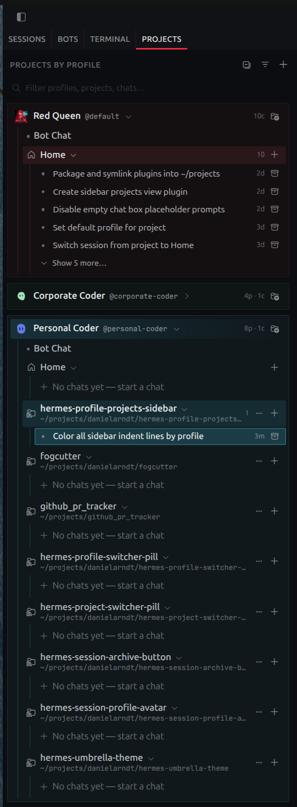

# Profile Projects Sidebar (`profile-projects-sidebar`)

A Hermes Desktop UI plugin that adds a dedicated **Projects** view tab (`SESSIONS | BOTS | PROJECTS`) to the left sidebar, organizing workspaces hierarchically by **Profile → Project → Session**.



## Features

- **Cross-Profile Hierarchy:** Queries every profile via `profiles.list` and resolves each profile's explicit (`projects.list`) and tree-grouped (`projects.tree`) projects and sessions over the gateway without cold-spawning secondary profile backends.
- **Profile Headers & Avatars:** Collapsible profile headers with full avatar resolution (`profiles.get_asset`, `Blobatar`, vector shapes, or monogram), live session/project counts, signature profile color tinting, and a one-click **Bot** pill that opens that profile's canonical `Bot Chat` (with a live `SessionStatusDot`).
- **Bot Chat Deliveries:** A plugin-wide 15-second activity poll marks new canonical Bot Chat messages unread even when the Bots and Projects panes are closed. Activity watermarks are persisted per connection, profile, and canonical chat, so deliveries during downtime are detected after reconnect; first sight seeds existing history rather than marking it unread. Opening the chat acknowledges it. Bot Chat rows use the same green unread / red pending-input glow as other chats.
- **Project Rows & Home Bucket:** Always-present **Home** (`__no_project__`) bucket sorted first per profile, custom project icons and colors, compact filesystem paths, and an always-visible `+` button to start a new chat directly in any `(Profile, Project)` pair.
- **Scheduled (Cron) Bucket:** Collapsible **Scheduled** bucket per profile displaying configured cron jobs with live countdowns, running states, and quick-trigger actions (`zap`). Expanding any job peeks recent execution run sessions with actionable status borders, opening transcripts on click.
- **Session Rows:** Glowing borders are reserved for actionable chats: green for an unread response, red for pending input (command approval or a clarification question). Working, quiet-but-running, background, draft, and idle sessions have no glow. The same rules apply to scheduled-run chats; active work shows a small yellow spinner (static when reduced motion is enabled). Includes a persistent archive/unarchive button and context menu actions to rename, open in new tab, move between projects (including back to Home), or delete.
- **Projects Without Sessions:** Sessionless projects are grouped under a collapsed **Show N projects without sessions** row per profile. Expand it to access their normal project controls; Home stays separate, search reveals matches automatically, and the **Show empty explicit projects** setting still applies.
- **Finished Sessions:** Projects with two or more chats marked **done** group them behind **Show x finished sessions**. Click again to **Hide x finished sessions**; a single finished chat stays inline, and search always reveals matching chats.
- **Auto-Archive Done Chats:** Optional sweep that archives chats you marked as **done** once they have been inactive for a configurable time (4 hours to 30 days, default 3 days), counted from the later of the chat's last activity and when you marked it done. Pinned, running, and currently open chats are never archived, and nothing is deleted. A chat that was auto-archived and then restored is left alone until you mark it done again.
- **Draft Retention:** Unsent text in a new chat is saved per `(Profile, Project)` and restored the next time you open a new chat for that pair. Each saved draft also shows as a `Draft` row at the top of its project (click to resume, `×` to discard); sending the message clears it.
- **Project Management:** Create, edit, delete, or transfer projects between profiles directly from the sidebar. Open a project's folder in VS Code from its `…` or right-click menu (requires the `code` CLI).

## Installation

### Symlink (Local Development)

```bash
ln -s ~/projects/danielarndt/hermes-profile-projects-sidebar ~/.hermes/desktop-plugins/profile-projects-sidebar
```

### Git Install (Hermes Desktop)

In Hermes Desktop, open **Settings → Plugins → Install from Git** and provide the repository URL or `danielarndt/hermes-profile-projects-sidebar`.

## Configuration

Configure under **Settings → Plugins → Profile Projects Sidebar**:
- **Profile section color tint:** `Off`, `Subtle`, `Medium`, or `Strong`
- **Show auto-discovered repositories**
- **Show Home (no-project) bucket**
- **Show Scheduled (cron) bucket**
- **Hide Scheduled bucket when empty**
- **Auto-archive done chats** (off by default), with **Archive done chats after**: 4 or 8 hours, or 1, 3, 7, 14, or 30 days of inactivity
- **Show empty explicit projects**
- **Show profiles without projects**
- **Show workspace folder paths on project rows**
