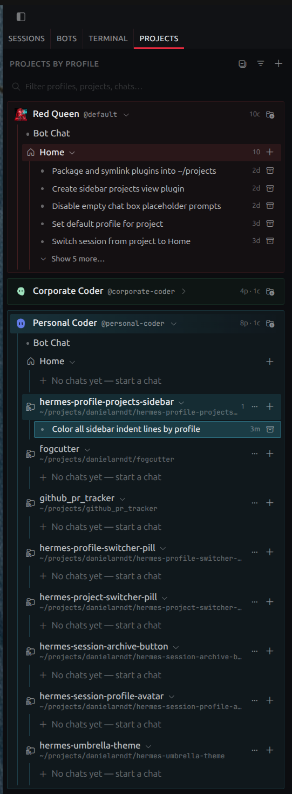

# Profile Projects Sidebar (`profile-projects-sidebar`)

A Hermes Desktop UI plugin that adds a dedicated **Projects** view tab (`SESSIONS | BOTS | PROJECTS`) to the left sidebar, organizing workspaces hierarchically by **Profile → Project → Session**.



## Features

- **Cross-Profile Hierarchy:** Queries every profile via `profiles.list` and resolves each profile's explicit (`projects.list`) and tree-grouped (`projects.tree`) projects and sessions over the gateway without cold-spawning secondary profile backends.
- **Profile Headers & Avatars:** Collapsible profile headers with full avatar resolution (`profiles.get_asset`, `Blobatar`, vector shapes, or monogram), live session/project counts, signature profile color tinting, and a one-click **Bot** pill that opens that profile's canonical `Bot Chat` (with a live `SessionStatusDot`).
- **Project Rows & Home Bucket:** Always-present **Home** (`__no_project__`) bucket sorted first per profile, custom project icons and colors, compact filesystem paths, and an always-visible `+` button to start a new chat directly in any `(Profile, Project)` pair.
- **Session Rows:** Live glowing working rectangle (`arc-border arc-row`) when a session is active, persistent archive/unarchive button, and context menu actions to rename, open in new tab, move between projects (including back to Home), or delete.
- **Draft Retention:** Unsent text in a new chat is saved per `(Profile, Project)` and restored the next time you open a new chat for that pair. Each saved draft also shows as a `Draft` row at the top of its project (click to resume, `×` to discard); sending the message clears it.
- **Project Management:** Create, edit, delete, or transfer projects between profiles directly from the sidebar.

## Installation

### Symlink (Local Development)

```bash
ln -s ~/projects/danielarndt/hermes-profile-projects-sidebar ~/.hermes/desktop-plugins/profile-projects-sidebar
```

### Git Install (Hermes Desktop)

In Hermes Desktop, open **Settings → Plugins → Install from Git** and provide the repository URL or `danielarndt/hermes-profile-projects-sidebar`.

## Configuration

Configure under **Settings → Plugins → Profile Projects Sidebar**:
- **Profile section color tint:** `Off`, `Subtle`, `Medium`, or `Strong`
- **Show auto-discovered repositories**
- **Show Home (no-project) bucket**
- **Show empty explicit projects**
- **Show profiles without projects**
- **Show workspace folder paths on project rows**
